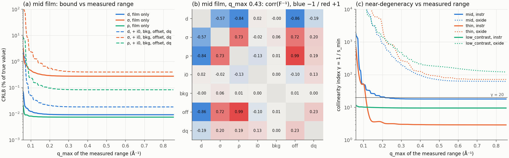
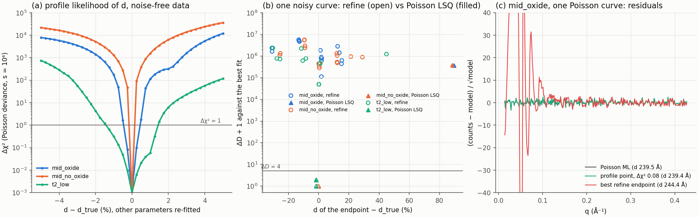

# Experiment 001: how much of a single film does one XRR curve determine?

The question behind this experiment: when a fit of a measured curve returns the wrong film, is that
because the optimizer stopped in the wrong place, or because the curve does not contain the answer
(several structures fit it within the noise)? The two need different fixes: a better fitting path in
the first case, a posterior that keeps several solutions in the second.

This first step is local. It computes, at the true structure, the Fisher information that Poisson
counts carry about the film and the nuisances refine fits with it, and reports which parameter
combinations are weakly determined. A local analysis can show that a direction is weak; it cannot rule
out a distant second solution. That is the next step (R1c).

## Model

- Stack: ambient / film / Si (SLD 20.07 × 10⁻⁶ Å⁻², roughness 3 Å, known). Scenario `oxide` adds a
  10 Å top layer (SLD 18.9, roughness 3 Å) between ambient and film, as in `data.generator` and
  `refine.make_forward`. In that stack the film's roughness is the buried oxide/film interface; the
  top surface roughness is the oxide's.
- Counts: `s · (i0 · R_res(q_eff) + 10^bkg)`, Poisson, as in `data.augmentations` (i0, background,
  Poisson steps). `q_eff` applies a 2θ zero offset as `physics.apply_tth_offset`. `R_res` is R
  convolved with a Gaussian of constant width `dq` in q, refine's resolution model.
- Truth for the nuisances: i0 = 1, offset = 0, dq = 0.002 Å⁻¹, background 10⁻⁷ unless stated.
- Not included: footprint (taken as corrected), Cu Kα2 (taken as monochromated), masked angles,
  any model error. Every result below assumes the fitted model is the true one.
- Grid: 2θ from 0.2° in 0.01° steps up to 3°, 6° or 12° (q_max 0.21, 0.43, 0.85 Å⁻¹), λ = 1.5406 Å.
- Films: `mid` 240 Å / 6 Å / 45 (the README and benchmark `fixed_mid` film), `thin` 90 Å / 3 Å / 28
  (benchmark `fixed_thin`), `low_contrast` 240 Å / 6 Å / 24 (film SLD close to Si).

Free parameters:

| scenario | free |
|---|---|
| `film` | d, σ, ρ |
| `instr` | d, σ, ρ, i0, bkg, offset, dq |
| `oxide` | `instr` + oxide thickness, SLD, roughness |

## Method

The Jacobian `J = ∂ ln counts / ∂θ` is taken by forward-mode autograd (`torch.func.jacfwd`) through
`physics.abeles_core` in complex128; `AbelesMatrix` itself runs in complex64, which is too coarse for
small singular values. Fisher information of Poisson counts is `F = Jᵀ diag(counts) J`. From it:

- CRLB: `sqrt(diag F⁻¹)`, the smallest standard deviation an unbiased estimator can reach under this
  model. Reported in % of the true value.
- Correlations of `F⁻¹`.
- `s_min`: the smallest singular value of the whitened Jacobian `diag(√counts) J` after its columns are
  scaled to unit norm. This makes it independent of the units of each parameter. Its right singular
  vector is the weakest direction in those normalized coordinates.
- Collinearity index `γ = 1/s_min` (Brun, Reichert and Künsch 2001). γ = 20 means some combination of
  parameters changes the curve 20 times less than the parameters do one at a time.

## Reproduce

```bash
uv run python experiments/001_identifiability/fim.py        # ~10 s on CPU
uv run pytest tests/test_identifiability.py
```

Writes `fim_results.csv` (all 243 cases: 3 films × 3 scenarios × 3 q ranges × 3 backgrounds × 3
count levels), `fim_tables.md` (the tables per film and scenario) and `fim.png` to this directory.

## Checks

- Forward model against `benchmark.parratt`, a float64 numpy Parratt recursion that shares no code
  with the torch engine: max relative difference in R of 5 × 10⁻¹⁵ over 2θ 0.2–12°. The engine's
  fixed `+1e-9j` Å⁻² absorption in every medium (ambient included), which the numpy code cannot
  represent, changes R by up to 1.2 × 10⁻³ near the film's critical edge. It is kept, so the model
  here is the one `AbelesMatrix` computes.
- Autograd Jacobian against central differences of a numpy re-implementation of the whole counts
  model (Parratt, offset, resolution, i0, background), all ten parameters of the `oxide` scenario:
  relative column error ≤ 6 × 10⁻⁸. Ten times larger steps give 100 times larger errors, so what
  remains is the finite-difference truncation error.
- Counts model against `refine.make_forward` (float32, the model refine and `refine.mcmc` fit with)
  with offset 0.01° and dq 0.002: max |Δ log₁₀ R| of 1 × 10⁻⁵. A resolution quadrature cut at ±3σ (as
  `benchmark.smeared` does) differed by up to 2 % at deep fringe minima, so the quadrature here spans
  ±5σ.
- `tests/test_identifiability.py` (4 tests, about 3 s) asserts the first two checks, that the CRLB
  scales exactly as `s^-1/2` with unchanged correlations, and that a parameter with no effect on the
  curve leaves F singular.

## Results

At 10⁶ counts at R = 1 (the middle of `augmentation.poisson_log_scale`), background 10⁻⁷, q_max 0.43
Å⁻¹. CRLB in % of the true value.

| film | free | CRLB d | CRLB σ | CRLB ρ | γ | weakest direction | largest correlation |
|---|---|---|---|---|---|---|---|
| mid | film | 0.009 | 0.28 | 0.008 | 1.4 | ρ + σ + d | σ–ρ 0.34 |
| mid | instr | 0.018 | 0.40 | 0.083 | 18 | offset + ρ | ρ–offset 0.995 |
| mid | oxide | 0.51 | 10 | 0.12 | 84 | d − ρ_ox − d_ox | d–ρ_ox −0.998 |
| thin | film | 0.042 | 0.97 | 0.016 | 1.6 | ρ − d + σ | d–ρ −0.52 |
| thin | instr | 0.043 | 1.2 | 0.028 | 2.9 | ρ + offset | ρ–offset 0.72 |
| thin | oxide | 2.6 | 51 | 0.031 | 103 | d − ρ_ox − d_ox | d–ρ_ox −0.998 |
| low_contrast | film | 0.036 | 0.40 | 0.010 | 1.2 | ρ + σ | σ–ρ 0.30 |
| low_contrast | instr | 0.041 | 0.43 | 0.061 | 9.5 | offset + ρ | ρ–offset 0.98 |
| low_contrast | oxide | 4.0 | 63 | 0.066 | 196 | d_ox − d + ρ_ox | d–d_ox −1.000 |



(a) CRLB of the mid film against the upper end of the measured range, with only the film free (solid)
and with the instrument nuisances free (dashed). (b) Correlations of F⁻¹ for the mid film, `instr`.
(c) γ against the measured range for each film, `instr` (solid) and `oxide` (dotted).

Measured range and noise (full tables in [`fim_tables.md`](fim_tables.md)):

- Range: for the two 240 Å films (σ 6 Å) the `film` and `instr` bounds are settled by q ≈ 0.25 Å⁻¹;
  going from 0.43 to 0.85 Å⁻¹ changes them by less than 1 %, because the counts are under the
  background by then. The thin film (σ 3 Å, slower fall-off) still gains on σ: −3 % (`film`) and
  −18 % (`instr`). With the oxide free, the extra range helps every film: d and σ bounds drop by
  24–38 % from 0.43 to 0.85 Å⁻¹, and for the mid film the d bound goes 5.0 % → 0.51 % → 0.37 % and γ
  783 → 84 → 62 for q_max 0.21 / 0.43 / 0.85.
- Counting statistics: in this model F is proportional to s, so every CRLB scales as `s^-1/2` and
  the correlations, γ and the weakest direction do not change with counting time. Counting longer
  shrinks the uncertainty along the weak direction but does not remove it.
- Background (10⁻⁸ to 10⁻⁶): with only the film or the instrument free it moves the d and ρ bounds
  by ≤ 1.2 % and the σ bound by up to 10 % (thin film). With the oxide free it matters: the d bound
  grows by up to 52 % (mid) and 92 % (thin, low contrast), the σ bound by 42–85 %.

## What this shows

Facts, under the stated model (no model error, local, Poisson):

1. With every nuisance known, d, σ and ρ of a single film are determined far better than the
   errors reported for refine: CRLB 0.01–0.04 % for d and ρ, 0.3–1 % for σ, γ < 2.
2. Freeing the 2θ offset creates one near-degenerate direction, offset together with ρ: correlation
   0.995 for the mid film, 0.98 for the low-contrast film, 0.72 for the thin film; γ 18, 9.5, 2.9.
   This is the offset–SLD valley of ReflectoLearn#14; FORUM T2 already computed it with a numpy
   Parratt copy for a 250 Å / 6 Å / 45 film (corr +0.997 at 10⁷ counts, six parameters), and this
   reproduces it through the torch engine. Even so the bounds stay small (ρ 0.08 % for the mid film
   at 10⁶ counts), and T2 showed that refine's 30 % SLD drift along this valley ends at a worse fit
   than the offset-free one: an optimization failure, not a second solution.
3. Freeing a top oxide layer (refine's oxide nuisance) is what makes the film practically
   non-identifiable: the film thickness trades against the oxide SLD and thickness (correlation
   −0.998 to −1.000), γ 60–1300. At q_max 0.21 Å⁻¹ the CRLB of d is 5 % (mid), 34 % (thin), 26 %
   (low contrast), and σ (here the buried oxide/film roughness) is not determined at all (82–590 %).
   ρ stays well determined (≤ 0.17 %). **Corrected by R1c:** this is the unbounded local result.
   Within refine's bounds (oxide SLD 15–22, Kα2 ratio ≤ 0.6) the weak direction is cut, and the
   profile likelihood of the same film on a 2θ 0.2–6° scan gives d to ±0.4 % (see R1c results).
   "Practically non-identifiable" holds only if the oxide SLD is left free over a wide range.

Prior work (`literature.md`): Poisson Fisher information and Cramér–Rao bounds for reflectometry
have been computed before for neutrons (Durant et al. 2021, 2022). For X-rays, Gil & Windover (2012)
showed by MCMC that a thin contamination layer dominates the film-thickness uncertainty, and Windover
et al. (2014) calibrated how an angle offset biases thickness and density. Facts 2 and 3 restate
those effects in Fisher terms with the refine nuisances; they are not new phenomena.

Inference (not yet tested):

- The SLD errors reported for refine (a few % up to 30 % in FORUM T2 and DECISIONS #1) are about
  two orders of magnitude larger than the `instr` bounds, so with the offset as the only nuisance they come from the fitting path or from model
  error, not from missing information. This is consistent with T2's finding that the drift arises in
  stage 2.
- A model error does not need to be large to move the fit along a weak direction. In a linearized
  fit, the bias is `F⁻¹ Jᵀ W δ` for a model error δ; in normalized coordinates the component along
  the weakest direction is the projection of the whitened δ divided by s_min, so a model error that
  happens to look like that direction is amplified by about γ (≈ 100 with the oxide free) relative
  to a well-determined direction. Whether the oxide nuisance absorbs model errors this way is the
  most useful next test (below).
- Where the oxide is free over a wide SLD range and q_max ≤ 0.2 Å⁻¹, a single best fit may be the
  wrong output. Not tested: R1c used refine's bounds and q_max 0.43 Å⁻¹.

## Where the truth curves come from (checked 2026-10-23 for RL#32)

`benchmark.make_synthetic` puts the oxide under the film (buried), while refine, the training
generator and `genx_fit` put it on top. Swapping the order changes R by a median 60 % (physics,
RL#32). No case in Experiment 001 (R1b, R1c, R2a, R2b, R2c, R2f) draws its truth from
`make_synthetic`. Every truth curve comes from one of three forward models, all with the oxide on
top: `fim.py` (R1b, R1c), refine's `make_forward` (R2b, R2c, R2f) or `scan.py` (R2a).
`benchmark.parratt` appears only in the forward-model checks, with the layers listed explicitly in
the same top-oxide order. So none of these results is a buried-versus-top model mismatch.

## Limits

- Local: F describes the curvature at the truth. Distant solutions with the same curve (for example
  across a fringe order, or a swapped layer order) are invisible to it. R1c tests this with
  multi-start fits and MCMC.
- No model error. Real curves carry footprint, Kα2, a q-dependent resolution, non-Gaussian
  roughness, a substrate that is not quite Si; each moves the estimate along the weak directions.
- CRLB is for an efficient (Poisson maximum-likelihood) estimator. refine minimizes a log-MSE with
  uniform weights over q and `refine.mcmc` uses a Gaussian likelihood in log₁₀ R; both are less
  efficient than this bound, by an amount not computed here.
- Three films only, one point each in (d, σ, ρ). γ depends on where in the parameter space the truth
  is; a scan over the training ranges (`config.yaml`) would show where the problem is hard.

## Next minimal experiments

1. Linearized misspecification bias (minutes of CPU): `δθ = F⁻¹ Jᵀ W δ` for model errors we know
   are present (constant vs q-proportional resolution, as in RL#20; Kα2 ratio; footprint; oxide
   under the film as in `benchmark.make_synthetic` vs on top as in refine), per scenario. Shows
   which nuisance turns which error into a film-parameter bias.
2. R1c: done, see below. Next for it: the pre-registered condition scan in
   [`generative_go_nogo.md`](generative_go_nogo.md).

## R1c pre-registration: non-uniqueness vs optimization failure (written before running)

Registered 2026-10-22 23:59, before any of the computations below were run. Results go in a separate
section; if a rule turns out unworkable it is changed in a new commit that says why, not edited here.

**Setup.** Lab-like scan: q uniform from q(2θ = 0.2°) to q(2θ = 6°), 291 points, λ 1.5406 Å.
Forward model as above plus the two effects refine also fits: Cu Kα2 (ratio 0.5, λ₂ 1.54439 Å, mixed
as in `make_forward`) and the footprint factor `erf(s_fp · sin θ)` with s_fp = 500. Truth: i0 1,
background 10⁻⁷, offset 0, dq 0.002 Å⁻¹, top oxide 10 Å / 18.9 / 3 Å. Free parameters: the twelve
refine fits (d, σ, ρ, i0, bkg, offset, dq, Kα2 ratio, footprint, oxide thickness, SLD, roughness),
within `RefineConfig`'s bounds for the nuisances. Counting level s = 10⁶ unless stated.

**Profile likelihood in d.** For noise-free data (the expected counts at the truth, "asymptotic data"
as in Raue et al. 2009), PL(d) is the Poisson deviance minimized over the other eleven parameters at
fixed d, by bounded least squares on deviance residuals, continued outward from the truth. Since
PL(d₀) = 0, Δχ²(d) = PL(d). The deviance is proportional to s, so one profile gives every counting
level.

**Labels for a case** (from the profile at s = 10⁶):
- *identifiable*: the Δχ² ≤ 1 interval of d is narrower than ±2 % of d.
- *ridge* (practical non-identifiability): the Δχ² ≤ 1 interval is connected and spans ≥ ±2 % of d.
- *multimodal* (non-uniqueness proper): PL has a second local minimum with Δχ² ≤ 1, separated from
  the truth by a barrier with Δχ² > 1.
- A "pair giving the same curve within the noise" is the truth and the profile point at Δχ² = 1
  farthest from it; reported with both curves and their normalized residual.

**Fits on one noisy curve** (Poisson draw, seed 0, s = 10⁶; zero-count points masked):
- Multi-start: `refine.refine` with default `RefineConfig` from 15 starts, d₀ × {0.8, 0.9, 1.0, 1.1,
  1.2} × ρ₀ × {0.85, 1.0, 1.15}, σ start 0.8 σ₀; plus one fit started at the truth.
- For each endpoint, D(endpoint) is the Poisson deviance against the noisy counts and D* the lowest
  D over all endpoints. An endpoint is *in the valley* if D − D* ≤ 4, an *optimization failure* if
  D − D* > 25, undecided in between.
- Verdict for the case: if the endpoints' spread in d is mostly in-valley endpoints and matches the
  profile's Δχ² ≤ 1 width (within a factor 2), the spread is information-limited (ridge or
  multimodal, as labelled above). If the spread comes from failure endpoints, it is optimization
  failure.
- MCMC: `refine.mcmc.sample_posterior` from the lowest-D endpoint (its Gaussian log₁₀ R likelihood,
  as implemented). Its 68 % interval of d is compared with the profile's Δχ² ≤ 1 interval; within a
  factor 2 counts as agreement. Runtime is measured on a short chain first; anything over 2 minutes
  is queued as [HEAVY].

**Cases.**
- Main: mid film (240 Å / 6 Å / 45), `oxide` scenario (γ = 84 at q_max 0.43 in the table above).
- Counter-example of known type: the same film with the oxide fixed (only the offset as a weak
  nuisance), where T2 already showed refine drifts by optimization failure; expected *identifiable*
  with failure endpoints.
- Open case: the 200 Å / 4 Å / 12 film (SLD below Si) from FORUM T2, which refine fitted 13 % high in
  every strategy ("oxide nuisance or film/substrate contrast ambiguity, unconfirmed"). Judged by the
  same rules; no expected label.

### Amendments to the pre-registration (made after the first runs, with reasons)

1. *Counter-example case.* "The same film with the oxide fixed" cannot be fitted by refine:
   `fit_oxide=False` removes the oxide layer rather than holding it at a known value, so refine would
   fit a model without the oxide that the data contain. The counter-example is therefore the mid
   film **without** an oxide in the truth, fitted with the oxide off (`mid_no_oxide`); everything
   else as registered. Found from the refine-model log-MSE of the truth (0.138 vs 0.018 with the oxide
   on), before the profile of the old case was looked at.
2. *Bounds and the Fisher result (correction to R1b).* The profile is computed within refine's
   bounds, as registered, and the bounds cut the weak direction: at the mid film with the oxide,
   Kα2 ratio and footprint free, the weakest direction is +0.67 Kα2 ratio +0.51 d −0.36 ρ −0.30 ρ_ox
   (γ = 125, CRLB of d 0.92 %), and the Kα2 ratio reaches its upper bound 0.6 and the oxide SLD its
   lower bound 15 within the first 0.5 % of d. With both held, the CRLB of d is 0.044 % (γ = 21). The
   unbounded Fisher analysis of R1b therefore overstates how far d can move: "practically
   non-identifiable" there means "within an unbounded local model". Whether d is identifiable under
   refine's bounds is decided by the profile, not by γ.
3. *Added, not registered:* every start is also fitted by the Poisson least-squares fit used for the
   profile (all twelve parameters free, nuisances started at refine's initial values), to see whether
   a different optimizer from the same starts reaches the same solution. And every point is also
   scored by refine's own forward model and objective (log₁₀ MSE over the nonzero counts), to tell a
   failed search from a difference between the two models.

### Review notes on this pre-registration (2026-10-23, after the physics cross-review of PR #24)

- The decisive evidence for "optimization failure" turned out to be amendment 3, which was added and
  not registered. The registered rule (Poisson ΔD > 25 against the best endpoint) cannot by itself
  tell a search that stopped early from a search that converged to the optimum of a different
  objective: refine does not minimize the deviance. Only scoring the endpoints on refine's own model
  and objective separates the two. The verdict below is therefore split by that unregistered test.
- The profile as registered ("continued outward from the truth") warm-starts each inner fit from the
  previous point and runs one local least-squares fit. It is an upper bound on PL(d), so its Δχ² ≤ 1
  interval is a lower bound on the true one, and "no second minimum" holds only along the tracked
  branch. The R2a scan does not rely on it to find modes: it runs 64 global starts per condition
  first and profiles each mode it finds, with restarts of the inner fit (see
  `generative_go_nogo.md`).
- Every label is conditional on refine's bounds (Kα2 ratio 0–0.6, oxide SLD 15–22 and the rest). In
  mid_no_oxide and mid_oxide the d profile is set where the Kα2 ratio or the oxide SLD reaches a
  bound. The bounds are physically reasonable, but they are a prior, not information in the curve.

## R1c results

Reproduce (about 4 minutes per case on CPU, mostly the profile; needs `uv sync --extra mcmc`):

```bash
for c in mid_oxide mid_no_oxide t2_low; do
  uv run python experiments/001_identifiability/nonunique.py profile fits lsq mcmc --case $c
done
uv run python experiments/001_identifiability/nonunique.py report
```

Writes `nonunique_<case>.json`, [`nonunique_tables.md`](nonunique_tables.md) and `nonunique.png`.
`mcmc` takes `--mcmc-start refine` (as registered) or `--mcmc-start ml`; both were run.

| case | label | profile Δχ² ≤ 1 (d, %) | refine endpoints: failure / worse on own objective | refine endpoint d (%) | Poisson LSQ from same starts at ML | MCMC 68 % of d (%), refine / ML start |
|---|---|---|---|---|---|---|
| mid_oxide | identifiable | −0.40 / +0.38 | 16/16, 16/16 (min ΔD 1.1e5) | −31 to +15 | 14/15 | +0.19 to +0.83 / +0.09 to +0.75 |
| mid_no_oxide | identifiable | −0.04 / +0.03 | 16/16, 13/16 (min ΔD 2.8e5) | −26 to +29 | 14/15 | −0.04 to +0.29 / −0.03 to +0.30 |
| t2_low | identifiable | −1.41 / +1.40 | 16/16, 14/16 (min ΔD 4.9e4) | −30 to +45 | 15/15 | −1.82 to −0.49 / −2.05 to −1.08 |



(a) Profile likelihood of d on noise-free data; every other parameter is re-fitted within refine's
bounds. (b) One Poisson curve per case: endpoints of refine (open) and of the Poisson least-squares
fit (filled) from the same 15 starts plus the truth, against their deviance above the best fit.
(c) Normalized residuals on the mid_oxide curve for the ML fit, a profile point inside Δχ² ≤ 1, and
the best refine endpoint.

Verdict by the registered rules:

- All three cases are **identifiable given refine's bounds**: no second minimum with Δχ² ≤ 1 out to
  ±30 % **along the tracked branch** (the profile follows one branch by continuation and is an upper
  bound on PL(d); see the review notes above), Δχ² ≤ 1 widths ±0.04 % to ±1.4 %. The mid_no_oxide
  width (−0.04 / +0.03 %) is below the 0.25 % profile grid: it is a quadratic extrapolation from the
  truth through the first grid points, where the Kα2 ratio jumps to its bounds (0 at −0.25 %, 0.6 at
  +0.25 %). The true half-width lies between about 0.03 % and the unbounded CRLB of 0.28 %.
  The deviance scales with s, so t2_low (Δχ² = 4.3 at d −2 %) would be labelled *ridge* at about
  2 × 10⁵ counts or fewer.
- None of the refine endpoints (−31 % to +45 % in d) is a second solution of the data: 48 of 48 are
  worse than the best fit by ΔD > 4.8 × 10⁴. **43 of 48 are optimization failures** in the strict
  sense: they are also worse on refine's own forward model and objective than the Poisson ML
  parameters. **5 of 48 are not**: refine's objective prefers them to the ML structure (log₁₀ MSE
  0.95–0.99 of the ML value: three mid_no_oxide endpoints including the truth start, two t2_low
  endpoints) while their deviance is 4.9 × 10⁴ to 4.5 × 10⁵ higher. Those are errors of the objective
  (log-MSE over nonzero counts is not the likelihood) or of refine's model (edge padding), and a
  better optimizer would not fix them. This split rests on amendment 3, which was not registered. A Poisson least-squares fit from the same starts reaches the ML fit
  from 43 of 45 starts; the other two (both d × 1.2, ρ × 0.85) land on a thickness alias near
  d ≈ 450 Å with ΔD ≈ 3.7 × 10⁵. Filed as ReflectoLearn#25 (not fixed here).
- T2's open case (200/12 film fitted 13 % high in SLD by every strategy) is reproduced: refine from
  the truth ends at ρ 13.2 (+10 %), the ML fit at 12.00. That endpoint is among the 43: on refine's
  own objective it is 1.10 times worse than the ML parameters. So it is an optimization failure, not
  a contrast ambiguity of the curve and not an objective error.
- MCMC (`refine.mcmc`, Gaussian likelihood in log₁₀ R) is unimodal in every case and gives the same
  interval from the failed refine endpoint as from the ML fit, so it escapes the failure. Its width
  agrees with the profile within the registered factor 2 only for mid_oxide (half-width 0.32 % vs
  0.39 %). It is 2–3 times narrower for t2_low. For mid_no_oxide it appeared 4.7 times wider, but the
  profile width there is below the profile's grid (above), so that ratio is **not established**.
  **Correction from R2c (2026-10-23):** these MCMC intervals come from unconverged chains. Run on the
  same kind of curves, `refine.mcmc`'s 2000 steps (1000 kept) are a quarter to a fifth of the 50
  integrated autocorrelation times that a converged estimate needs (τ 76–97 at 2000 steps, and τ keeps
  growing with chain length, up to 208–893 at 20000). The MCMC column of the table above is therefore
  not a calibrated interval, and nothing in R1c about MCMC widths (agreement for mid_oxide, 2–3 times
  narrower for t2_low) is established. See `mcmc_width.md`.

Side observations (not part of the registered rules):

- In t2_low the ML fit puts the film roughness at its bound 0 (truth 4 Å) and moves the oxide
  (14 Å / 16.2 instead of 10 Å / 18.9) without changing d or ρ; two ML solutions that differ only in
  the Kα2 ratio (0.51 vs 0.00) are within ΔD = 1. With the oxide on top, the film's roughness is the
  buried oxide/film interface, and these nuisances trade against it. d was profiled; σ was not.
- `make_forward` pads the grid edges before smearing; with the footprint on this changes R by up to
  3.6 % at the first grid point and 13 % at the last. Recorded in #25.
